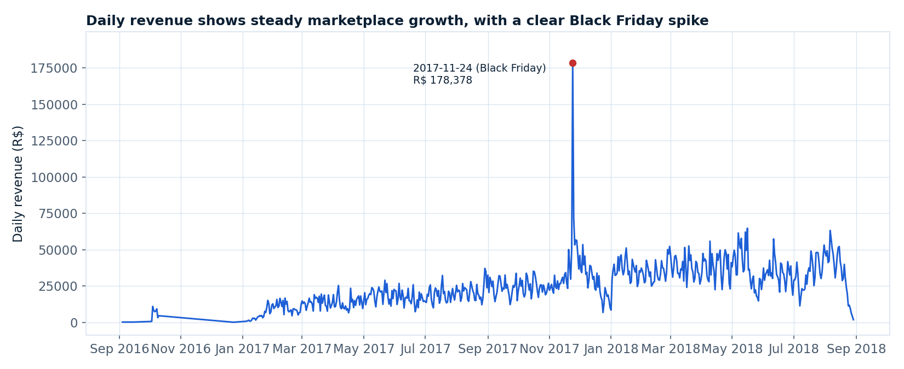
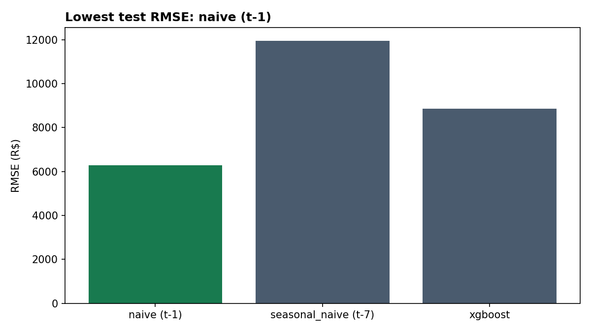
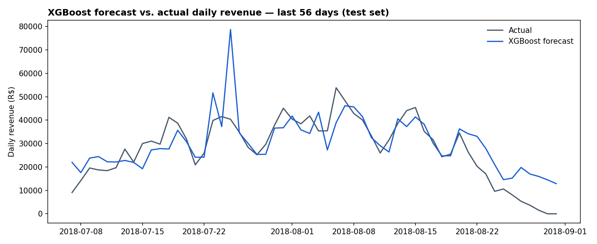

# Retail Sales Forecasting

[](https://github.com/abatista346/retail-sales-forecasting/actions/workflows/tests.yml)

> Time-series forecasting pipeline for daily e-commerce revenue, benchmarking a gradient boosting model against naive baselines on real transaction data.

## Problem

Retailers need to forecast near-term demand to plan inventory, staffing, and cash flow. This project builds a daily revenue forecasting pipeline end to end — ingestion, cleaning, feature engineering, and model evaluation — on a real, publicly available e-commerce dataset, and asks the question every forecasting project should ask first: **does the model actually beat a naive guess?**

## Data Source

[Brazilian E-Commerce Public Dataset by Olist](https://www.kaggle.com/datasets/olistbr/brazilian-ecommerce) — ~100k orders placed on the Olist marketplace between September 2016 and September 2018, across Brazil. Data © Olist, released publicly on Kaggle under its dataset terms.

Not included in this repository (raw CSVs are gitignored — third-party data shouldn't live in git). See [Setup](#setup) to fetch it yourself.

## Solution

1. **Ingestion** (`src/ingest.py`) — pulls the dataset via `kagglehub`.
2. **Preprocessing** (`src/preprocessing.py`) — joins orders, order items, products, customers, payments, and reviews into a single order-item table, dropping canceled/unavailable orders.
3. **EDA** (`notebooks/eda_storytelling.ipynb`) — visual analysis of growth, seasonality, category and geographic concentration, and the delivery-time/review-score relationship.
4. **Feature engineering** (`src/feature_engineering.py`) — aggregates to a daily national revenue series with date features, lags (1/7/14/28 days), and rolling mean/std (7/28 days).
5. **Baseline** (`src/train_baseline.py`) — naive (t-1) and seasonal-naive (t-7) persistence forecasts, evaluated on the last 56 days.
6. **Model** (`src/train_model.py`) — an XGBoost regressor, tuned on a time-based validation split (not the test set), evaluated on the same held-out 56 days.

## Tech Stack

Python, pandas, XGBoost, scikit-learn, matplotlib, Jupyter, kagglehub

## Key Findings (EDA)



- **Growth + a real demand shock**: daily revenue grows steadily through the dataset's window, with an unmistakable spike on Black Friday (Nov 24, 2017) — revenue hit R$178k that day vs. a ~R$40k 30-day median.
- **Weekday effect**: weekday revenue runs ~35% higher than weekend revenue.
- **Concentration risk**: the top 10 of ~70 product categories drive 62% of revenue, and São Paulo alone accounts for 37% of revenue — a single national aggregate series is a reasonable first pass, but a state- or category-level breakdown would likely forecast better.
- **Delivery time drives satisfaction**: average review score drops from 4.45 (0-4 day delivery) to 3.14 (21+ days) — a clear operational lever, independent of forecasting.

See the [EDA notebook](notebooks/eda_storytelling.ipynb) for the full analysis and all five charts.

## Model Results

Evaluated on the last 56 days of the series (held out from training and from XGBoost hyperparameter tuning):

| Model | RMSE (R$) | MAE (R$) | MAPE |
|---|---|---|---|
| **Naive (t-1)** | **6,279** | **5,091** | **23.9%** |
| Seasonal-naive (t-7) | 11,951 | 9,576 | 81.1% |
| XGBoost | 8,857 | 6,226 | 50.6% |



**Honest result: the naive t-1 baseline wins.** XGBoost clearly beats seasonal-naive, but not simple "predict yesterday's value" — day-to-day autocorrelation is stronger than weekly seasonality in this aggregate series, and 56 test days plus ~450 training days isn't much for a tree model to learn a reliable pattern from, especially with a real trend shift and a data-collection drop-off near the end of the window (the last few days of the dataset show an artificial decline toward zero — visible in the forecast chart below).



This is reported as-is rather than tuned against the test set until XGBoost "wins" — a forecasting model that can't beat a naive baseline is a real and useful finding, not a failure to hide.

## Architecture

```
data/raw/            <- gitignored, populated by src/ingest.py
data/processed/       <- gitignored, populated by preprocessing + feature engineering
src/
  ingest.py            <- kagglehub download
  preprocessing.py     <- table joins, cleaning
  feature_engineering.py <- daily aggregation, date/lag/rolling features
  train_baseline.py    <- naive & seasonal-naive baselines
  train_model.py        <- XGBoost training + evaluation + plots
notebooks/
  eda_storytelling.ipynb
outputs/
  figures/             <- exported charts
  metrics.json          <- baseline + model metrics
```

## Setup

1. `pip install -r requirements.txt`
2. `python src/ingest.py` (public dataset — no Kaggle API token required)
3. `python src/preprocessing.py`
4. `python src/feature_engineering.py`
5. `python src/train_baseline.py`
6. `python src/train_model.py`
7. Optionally, open `notebooks/eda_storytelling.ipynb` for the full visual EDA

Run the test suite with `pip install pytest && pytest` — it uses synthetic data, so no dataset download is needed.

## What I'd Improve Next

1. Add an explicit Black Friday / Brazilian holiday calendar as a regressor instead of letting the model treat it as unlabeled noise — it's the single largest driver of forecast error around late November.
2. Forecast at the state or category level instead of a single national aggregate, since the EDA shows demand is concentrated enough that sub-series likely have more learnable structure than the blended total.
